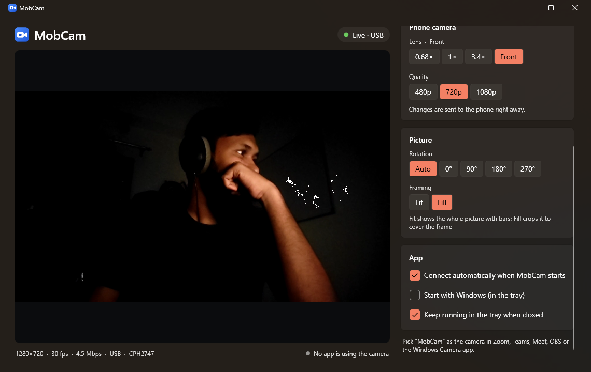
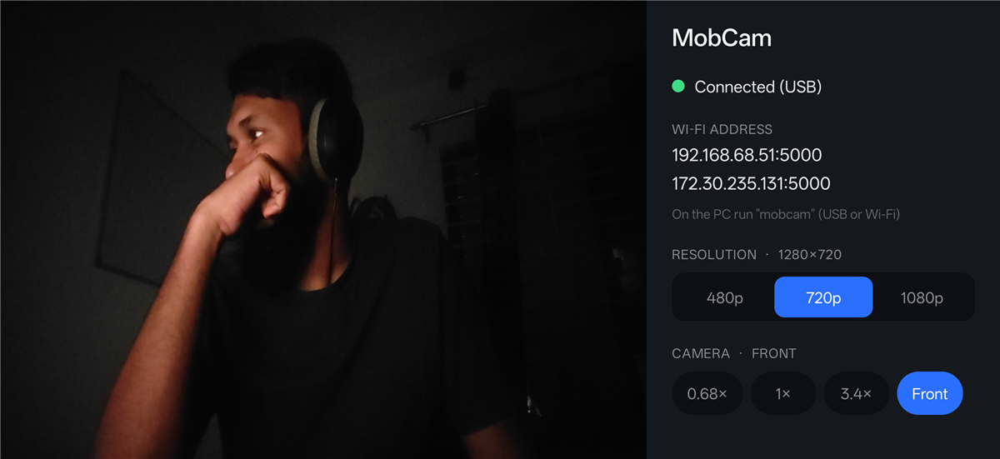

<div align="center">


# MobCam

**Turn your Android phone into a high-quality webcam for Windows 11, over USB or Wi-Fi.**

[](https://github.com/Ishtiaqasif/mobcam/releases/latest)
[](https://github.com/Ishtiaqasif/mobcam/actions/workflows/ci.yml)
[](LICENSE)


[**Download**](#download) · [Features](#features) · [How it works](#how-it-works) · [Build from source](#development)



</div>

## Download

Get both files from the [latest release](https://github.com/Ishtiaqasif/mobcam/releases/latest):

| | File | Requirements |
|---|---|---|
| 🖥️ **Windows** | `MobCam-Setup-<version>.exe` | Windows 11 (x64). Nothing else; the .NET runtime is included. |
| 📱 **Android** | `MobCam-<version>.apk` | Android 7.0+ (arm64) |

### Setup

1. **PC:** run the installer. It installs the MobCam app and the **MobCam** virtual camera.
2. **Phone:** open the APK and allow installing from this source when Android asks.
3. Open MobCam on the phone, then on the PC. They find each other automatically:
   - **USB** (lowest delay, charges the phone): turn on **USB debugging** in the phone's
     *Developer options* and accept the prompt when you plug it in.
   - **Wi-Fi**: phone and PC on the same network. Allow MobCam through the Windows firewall
     the first time.
4. **Pair (Wi-Fi, first time only).** Both screens show the same 6-digit code. Check that they
   match, then tap **Allow** on the phone and **Codes match** on the PC (either order). After that
   the PC reconnects without asking. USB never needs pairing.
5. In Zoom, Teams, Meet, OBS, your browser or the Camera app, choose **MobCam** as the camera.

Paired devices are listed under **Paired PCs** on the phone and **Paired phones** in the PC app;
*Forget* removes one. To pair again after forgetting, forget it on **both** sides.

## Features

- **Up to 1080p at 30 fps**, hardware H.264 encoding on the phone and low-latency decoding on the PC
- **Real Windows camera**: shows up as *MobCam* in every app, no OBS or plugins needed
- **USB or Wi-Fi**, with automatic discovery and reconnection
- **Private**: Wi-Fi needs a one-time pairing confirmed on both devices, and video and commands are
  encrypted (AES-256-GCM), so others on the same network can't watch or control the camera
- **Every lens**: ultra-wide, wide, telephoto and front camera, switchable from the phone or the PC
- **Always upright**: follows how the phone is mounted; manual rotation and Fit/Fill framing too
- **Remote control** of lens and quality from the PC
- Live preview, tray mode and start with Windows
- Command-line client (`mobcam-cli`) for scripting

<div align="center">

</div>

## Privacy

No accounts, no analytics, no ads, no servers. The video goes from your phone to your own PC,
over the USB cable or your local network, and is never recorded or sent anywhere else. Neither
app connects to the internet. Pairings and settings stay on your devices. Details, including
what is stored where and how to remove it: [PRIVACY.md](PRIVACY.md).

## How it works

```
 phone (app/)                                    PC (pc/)
┌───────────────────────────┐   TCP :5000    ┌──────────────────────────────┐
│ Expo / React Native UI    │ H.264, AES-GCM │ MobCam.exe (WPF)  mobcam-cli │
│ Kotlin module:            │ ─────────────▶ │        └── mobcam-core.dll   │
│  Camera2 → MediaCodec     │ ◀───────────── │  decode, rotate, fit/fill    │
│  TCP server, pairing      │    commands    │          │ shared memory      │
└───────────────────────────┘  USB or Wi-Fi  │ mobcam-source.dll (Frame     │
                                             │  Server virtual camera)      │
                                             └──────────────────────────────┘
```

The phone captures with Camera2 straight into the hardware H.264 encoder (no frame copies) and
serves the stream over TCP. Over USB the PC tunnels it with `adb forward`; on Wi-Fi it finds the
phone with a UDP broadcast. Every connection starts with an authenticated key exchange (pairing
on first use over Wi-Fi), and everything after it is encrypted. The PC decodes with Media Foundation, applies rotation and framing,
and hands the frames to a Media Foundation virtual camera (`MFCreateVirtualCamera`, Windows 11)
that Windows Frame Server exposes to all apps. Details: [docs/protocol.md](docs/protocol.md).

## Repository layout

| Path | What |
|---|---|
| [app/](app/) | Android app (Expo SDK 58, React Native). Camera, encoder and server live in the local native module [app/modules/mobcam-stream/](app/modules/mobcam-stream/) (Kotlin). |
| [pc/core/](pc/core/) | C++ engine with a C API ([mobcam_core.h](pc/core/mobcam_core.h)): discovery, adb, decoding, picture processing, virtual camera control. |
| [pc/gui/](pc/gui/) | Windows app `MobCam.exe` (WPF, .NET 10, Fluent theme). |
| [pc/cli/](pc/cli/) | `mobcam-cli.exe`, command-line client and elevated installer helper. |
| [pc/source/](pc/source/) | `mobcam-source.dll`, the virtual camera loaded by Windows Frame Server. |
| [pc/common/](pc/common/) | Shared PC code (shared-memory layout, NV12 scaling). |
| [pc/installer/](pc/installer/) | Inno Setup script for the Windows installer. |
| [docs/](docs/) | [Protocol](docs/protocol.md) documentation and README images. |
| [scripts/](scripts/) | Dev, release and icon scripts. |

## Development

Everything builds from the command line on Windows 11; no IDE needed.

**Prerequisites:** Node.js, Android SDK platform-tools, JDK 17 (`winget install Microsoft.OpenJDK.17`),
Visual Studio 2022 **Build Tools** with the C++ workload and Windows 11 SDK, .NET 10 SDK, and for
release builds Inno Setup (`winget install JRSoftware.InnoSetup`).

```powershell
npm run phone           # debug build of the phone app on a USB-connected phone (+ Metro)
npm run phone:typecheck
npm run pc:run          # build the PC side into pc\build\bin and start MobCam.exe
npm run icons           # regenerate app icons (scripts/make-icons.ps1)
```

A development build of MobCam.exe offers to **install/update the virtual camera** (one UAC
prompt). It copies `mobcam-source.dll` to `C:\Program Files\MobCam`, because Frame Server can't
load it from a user folder. Debug and release APKs are signed with different keys, so uninstall
one before installing the other (`adb uninstall com.mobcam.app`).

### Releasing

Development happens on `dev`; `main` only receives pull requests and holds released code
(see [CONTRIBUTING.md](CONTRIBUTING.md#branches)).

```
feature ──PR──▶ dev ──PR "Release x.y.z"──▶ main ──tag vx.y.z──▶ GitHub Actions builds, signs, publishes
```

1. **Bump on `dev`** (every change goes under `## [Unreleased]` in [CHANGELOG.md](CHANGELOG.md)
   as it lands):
   ```powershell
   npm run bump -- 1.2.3     # csproj + app.json version, Android versionCode + 1, CHANGELOG section
   git commit -am "Release 1.2.3"; git push
   ```
2. **Pull request `dev` → `main`**, titled "Release 1.2.3". Merge it with a merge commit once CI
   passes.
3. **Tag `main`**:
   ```powershell
   git switch main; git pull; git tag v1.2.3; git push origin v1.2.3
   ```
   The [Release workflow](.github/workflows/release.yml) checks that the tag is on `main` and
   matches the version and changelog, builds the signed APK and the installer, and publishes the
   GitHub release with `SHA256SUMS.txt` and the changelog section as notes (about 15 minutes).
   Tags like `v1.3.0-rc.1` become pre-releases.

**Test builds without releasing:** GitHub → Actions → **Release** → *Run workflow* on any branch
builds the same signed APK and installer and attaches them to the run as artifacts; nothing is
published.

CI signs the APK with the key stored in the repository secrets `ANDROID_KEYSTORE_BASE64` and
`ANDROID_KEYSTORE_PASSWORD`. The same key lives locally in `%USERPROFILE%\.mobcam\`
(`mobcam-release.jks` + `keystore.properties`) and is used by `npm run release` for local builds.
**Keep an offline backup**: Android only installs updates signed with the same key.

## Troubleshooting

- **MobCam doesn't appear in my video app:** make sure MobCam.exe is running (tray icon). The
  camera exists only while it runs.
- **Phone not found on Wi-Fi:** same network on both, MobCam open on the phone, firewall allowed.
  You can also type the phone's address (shown on the phone) in the PC app.
- **USB not detected:** USB debugging on, prompt accepted, and a data cable (not charge-only).
- **Phone says "A PC with an old MobCam version tried to connect"** (or the PC says the phone app
  is too old): phone and PC apps from before pairing (1.0.0) can't talk to newer ones. Update both.
  If you build from source, exit the installed MobCam from the tray first; the Start menu opens
  the installed copy.
- **PC says "This PC forgot the phone"**: the phone still trusts this PC. On the phone, open
  **Paired PCs**, forget this PC, then connect again and pair.
- **No pairing code appears:** the phone shows its prompt only for Wi-Fi connections from PCs it
  doesn't know; USB and paired PCs connect without one. To pair again, forget on both sides.
- **"Pairing was denied" / "cancelled" / "timed out":** nothing was saved; click **Connect** and
  confirm on both devices within a minute.
- Virtual camera log: `C:\ProgramData\MobCam\mobcam-source.log`.
- Testing the raw stream with `ffplay tcp://<phone>:5000` no longer works: every connection is
  encrypted (see [docs/protocol.md](docs/protocol.md)).

## Roadmap

Planned work lives on GitHub: the pinned [🗺️ Roadmap issue](https://github.com/Ishtiaqasif/mobcam/issues/21)
lists every item, [milestones](https://github.com/Ishtiaqasif/mobcam/milestones) group them into
releases, and the [project board](https://github.com/users/Ishtiaqasif/projects/4) shows what is in
progress. Ideas and questions go to [Discussions](https://github.com/Ishtiaqasif/mobcam/discussions).

## Contributing

Issues and pull requests are welcome; see [CONTRIBUTING.md](CONTRIBUTING.md) and the
[Code of Conduct](CODE_OF_CONDUCT.md). Found a security problem? Please report it privately
([SECURITY.md](SECURITY.md)).

## License

[MIT](LICENSE)
